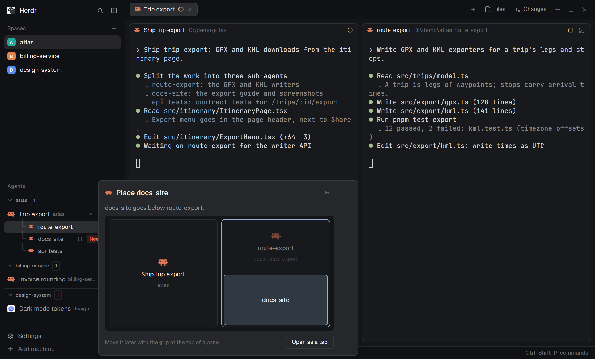
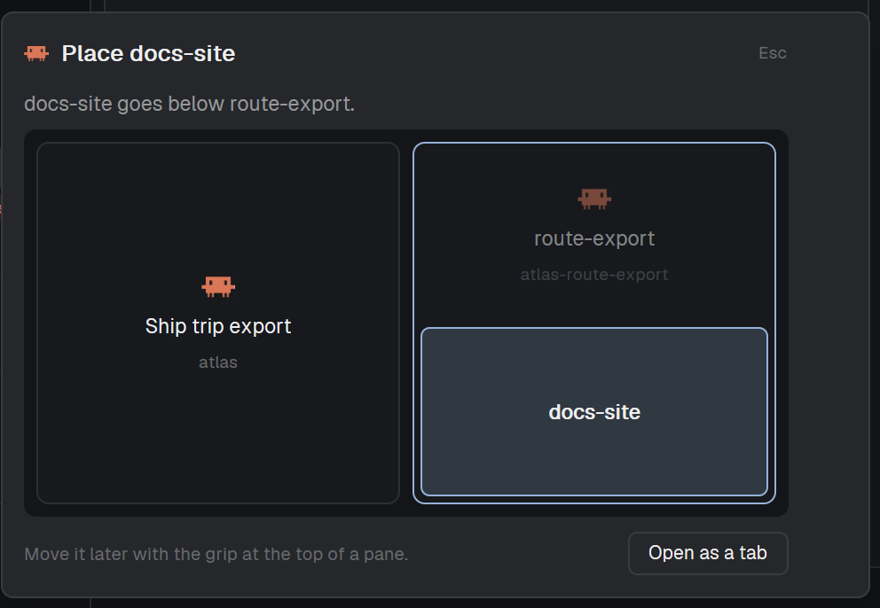
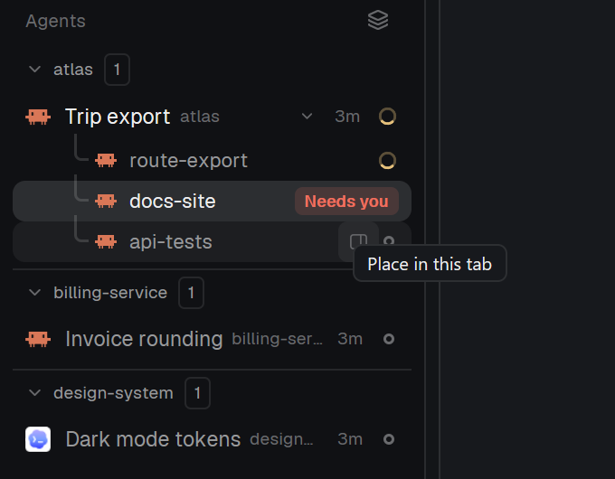
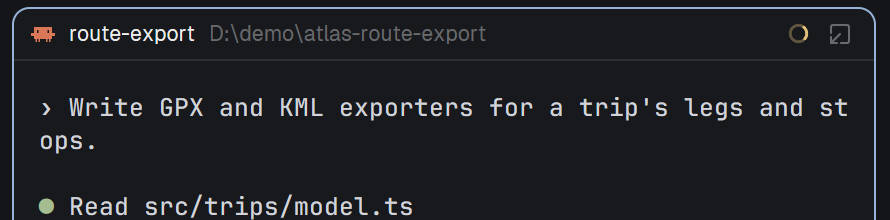

# Agents Drag n Drop

A mod for [Herdr Desktop](https://herdr.dev): drag a sub-agent out of the agents
list and drop it into the tab you're looking at, beside any pane.



- **Drag and drop.** Drag a sub-agent row and a drop map opens under the pointer:
  the shown tab's panes as cards. Hover an edge to preview the split, let go to
  place the sub-agent's terminal there as a pane. Or hover the row and click its
  place button.
- **Detach.** A sub-agent's pane header always shows Detach: it goes back under its
  agent in the list, still running. The header's × would end it.
- **Names, not "Claude Code".** A sub-agent goes by its name and what it's working
  on, from its session title: `pr-12`, titled "PR-12: Retry failed uploads", reads
  `pr-12  Retry failed uploads` in the list, its pane header and the drop map. An
  agent's pane header shows its session title ("Ship trip export").
- **An agents list built for sub-agents.** Sub-agents nest under their agent and are
  listed once, with a pane or without. Group by space, main space (worktrees with
  their repository), name prefix or priority. Pins are Herdr's own.
- **Copy and Paste on right-click.** The terminal's right-click menu adds Copy and
  Paste for the terminal you clicked. Copy stays greyed out until text is selected,
  so it never reaches a working agent as Ctrl+C.

| Drop map | Agents list | Pane header |
|---|---|---|
|  |  |  |

## Install

Copy this prompt into your Herdr agent:

> Read ~/.config/herdr-app/AGENTS.md, then add this mod: https://github.com/mikedepo/herdr-agents-drag-n-drop

By hand: copy `mods/agents-drag-n-drop/` into `~/.config/herdr-app/mods/`. Then, in a
layout of your own (Herdr's shipped layouts are read-only: clone `main` with
`herdr-app do layout.clone '{"name":"main","as":"my-main"}'`), point three places at
the mod:

```json
{ "id": "agents", "type": "block", "content": { "mod": "agents-drag-n-drop" } }
```

```json
"pane": { "header": { "content": { "mod": "agents-drag-n-drop" }, "height": 30, "position": "top", "reveal": "always" } }
```

and, at the layout's root:

```json
"terminal_menu": "agents-drag-n-drop"
```

[RECIPE.md](RECIPE.md) describes the whole mod, for building it from scratch.

## What it runs

Herdr commands only (`terminal.keep`, `pane.swap`, `terminal.park`,
`terminal.copy`, ...). The one
program it starts is `git rev-parse`, read-only, while "Grouped by main space" is
chosen. No network.

Built and tested with Herdr Desktop 0.1.16 on Windows.

## License

Apache License 2.0. See [LICENSE](LICENSE) and
[mods/agents-drag-n-drop/NOTICE.md](mods/agents-drag-n-drop/NOTICE.md).
