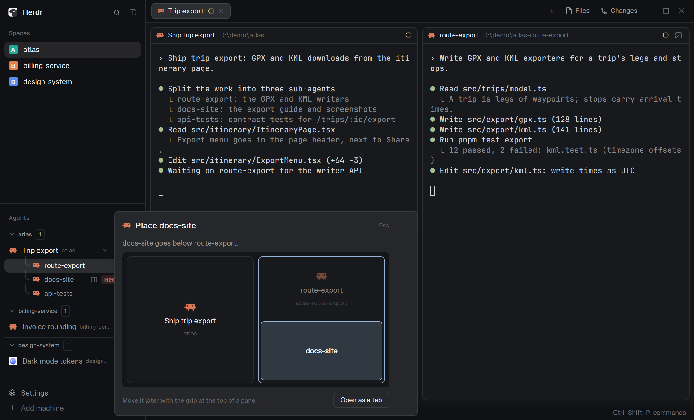

# Agents Drag n Drop

Put a sub-agent on screen where you want it. Drag a sub-agent out of the agents
list and a drop map opens under the pointer: the shown tab's panes as cards, and
the edge you hover previews the split it will make. Let go and the sub-agent's
terminal lands there as a pane. Its pane header names it (`route-export`, not
"Claude Code"), says what it's working on, and carries a Detach button that sends it back under its agent,
still running, where the header's × would have ended it. The agents list it
lives in nests sub-agents under their agent, lists each one once, and groups by
space, main space, name prefix or priority.

## What you see

Three parts, all drawn by one mod.

**The agents list**, a sidebar block on `chrome`, 13px text:

- A 41px heading: "Agents" (11.5px, medium, `dim`) at 16px from the left, and at
  the right a 26px sort button whose icon is the current sort (`clock`, `layers`,
  `git-branch` or `tag`).
- Group headers, 30px: a 12px chevron, the group's name (11px, medium, `muted`;
  under Priority, coloured by its status) and a count badge (10px, 1px `border`,
  radius 4). Groups after the first have a 1px `border` line above them.
- A **Pinned** group above every other, for agents pinned with Herdr's pin.
- Agent rows, 30px, radius 8: the program's 16px icon, the tab's name (`foreground`,
  `muted` when idle and not focused, at most 140px), then the space's name (11px,
  `dim`). A remote agent also shows its machine. At the right: a fold chevron when
  it has sub-agents, the time since its status changed (11px, `dim`: `<1m`, `9m`,
  `2h`, `3d`), and its status. The focused agent's row is filled `selected`.
- Sub-agent rows under their agent, 26px, indented 39px, joined by tree rails
  (1.5px `input` lines, rounded 6 where they turn): a 14px program icon, the
  sub-agent's name (12.5px), what it's working on (11px, `dim`, the whole of it
  as a tooltip), and its status. Hovering one that has no pane shows a
  place button (`panel-right`, 13px) before the status.
- Narrower than 160px: a rail of numbered rows with only their status, and `»`
  at the bottom to widen it again.

Statuses, the same everywhere: **working** a 12px spinner in `working`, turning once
every 900ms; **blocked** a "Needs you" badge (18px high, radius 5, `blocked` text on
`blocked` at 15%), or a 14px "!" square under Priority, whose section already says
so; **done** a 7px `done` dot; **idle** a 7px ring in `idle`.

**The drop map**, a popup at the pointer: 520px wide, 14px padding, 10px gaps.

- "Place docs-site" (15px semibold) after the sub-agent's 16px icon, then what it's
  working on (`muted`); "Esc" (11px, `dim`) at the right.
- One `muted` line saying what will happen: "Drop it on the edge of a pane where it
  should go.", then "docs-site goes below route-export." while aiming.
- The map, 250px high on `canvas`, radius 8: the shown tab's panes as cards in a
  grid of ⌈√n⌉ columns, 8px apart. A card has radius 8, a 1px `border` (`accent`
  for the focused pane), and in its middle the program's 22px icon, the pane's
  name, and under it what a sub-agent is working on, else its folder (11px, `dim`).
- Aiming at a card shows the split: the card divides at that edge into the pane,
  dimmed to half, and a landing block with the sub-agent's name (semibold) and what
  it's working on (11px, `muted`) on `accent` at 20% with a 1px `accent` border, radius 6.
- A footer: "Move it later with the grip at the top of a pane." (11.5px, `dim`)
  and a 28px "Open as a tab" button; "Go to it" instead when the sub-agent already
  has a pane.

**The pane header**, on every pane: full width, 12px text on `background`, a 1px
`border` line on the side facing the terminal. The program's 14px icon, the pane's
name (medium, at most 260px), what a sub-agent is working on (`muted`), its folder
(`dim`), its status, then:

- On hover: split right, split down, zoom (or unzoom) and close, 14px icons in
  `dim` that turn `foreground` on hover.
- On a sub-agent's pane, always, and last: Detach (`detach`), tooltip "Detach: back
  to the agents list, still running".

The pane's name is its terminal's name when it has one (`route-export`), else the
agent's session title as it set it ("Ship trip export", without Claude Code's ✳),
else the program's name.

What a sub-agent is working on is its session's title too, after any reference its
name already gives: `pr-12`, titled "PR-12: Retry failed uploads" or "M2.pr-12 Retry
failed uploads", is working on "Retry failed uploads". Only an agent with a name
has one, and none when its title is only its name, a path or the program's name.

## How it behaves

- **Drag a sub-agent row** at least 6px: the drop map opens under the pointer, and
  the same drag carries on into it. Moving over a card aims at its nearest edge
  (the card is cut along its diagonals); releasing there places the sub-agent.
  Clicking an edge does the same. Leaving the map clears the aim.
- **The place button** on a hovered sub-agent row opens the same map at the
  pointer, for clicking.
- **Placing** focuses the target pane, gives the sub-agent a pane right of or below
  it, waits for that pane (up to 5 s), swaps the two for left or above, focuses the
  new pane and closes the map. A release only places on a card the pointer has moved
  over since the map opened, so letting go as it appears places nothing.
- **Open as a tab** gives the sub-agent a tab of its own. **Esc** or a click
  outside closes the map with nothing changed. A sub-agent that already has a pane
  gets "Go to it"; one that ended says so.
- **Detach** takes the pane away; the sub-agent keeps running and is back under its
  agent in the list. The × still closes the pane and ends it.
- **Clicking** an agent row focuses its pane. A sub-agent row goes to its pane
  when it has one, else opens Herdr's peek over the tab. Clicking an agent's icon
  or its chevron folds its sub-agents; folded, the chevron shows how many, coloured
  by the most urgent. Clicking a group header folds the group; folded, outside
  Priority, it shows the group's most urgent status.
- **Hovering** an agent row swaps its time for a pin button: pin and unpin use
  Herdr's own pin, shared with Herdr's list and every window.
- **A sub-agent with a pane** is listed once, nested under its agent, unless
  pinned.
- **Sorting**, from the sort button's menu: Priority (sections Needs you, Done,
  Working, Idle; an agent ranks as its most urgent sub-agent; a done agent you
  look at stays in Done until you leave it), Grouped by space, Grouped by main
  space (a worktree's agents with its repository's open main checkout, under that
  space's name, else the repository's folder name), and Grouped by prefix (`PR-12`,
  `INS-4`, `PLAT-work`, also after a `/`; lower case needs a number after the dash;
  "No prefix" last). The choice is Herdr's shared `agents.sort`.
- Next and previous agent keys follow the list's order.
- Times redraw every 30 s. Nothing animates by timer: the spinner turns natively.

## Built from

- **One mod folder**, `mods/agents-drag-n-drop/`, `mod.json`
  `{ "place": "none", "title": "Agents Drag n Drop" }`. `main.js` picks the part
  each copy draws: `props.view === "drop"` the drop map (`drop.js`), `props.pane`
  (given to pane headers by the app) the header (`header.js`), anything else the
  agents list (`agents.js`). Beside them: `names.js` (a pane's name and a sub-agent's
  task, shared by the list, the header and the map), `parents.js` (the main-space lookup), `ui.js` (sizes, icons,
  badge, buttons, group header, menu, tree rail), `find-node.js`, `icons/` (17
  one-colour SVGs drawn with `svg()`), `NOTICE.md`.
- **Two references in a layout the person owns**, nothing else changed:
  - the agents block: `{ "id": "agents", "type": "block", "content": { "mod": "agents-drag-n-drop" } }`;
  - the tab block's pane header: `"pane": { "header": { "content": { "mod":
    "agents-drag-n-drop" }, "height": 30, "position": "top", "reveal": "always" } }`.
  The sidebar column's id is `sidebar` (the rail reads its width).
- **The drop map** is opened by the list with `openOverlay({ mod:
  "agents-drag-n-drop", kind: "popup", width: 560, height: 400, at, props: { view:
  "drop", terminal, name } })`.
- **herdr**: `agents`, `terminals`, `panes`, `focused`, `spaces`, `run`, `theme`,
  `shared`, `setShared`, `setAgentOrder`, `window`, `layout`, `openOverlay`,
  `closeOverlay`, `settings`, `props`, `home`, `exec`. **Commands**: `pane.focus`,
  `terminal.keep`, `pane.swap`, `terminal.park`, `terminal.peek`, `terminal.pin`,
  `pane.split`, `pane.zoom`, `pane.close`, `layout.resize`. **gpui-base**:
  `h_flex`, `v_flex`, `Popover` (the sort menu).
- **Programs**: only `git rev-parse --path-format=absolute --git-common-dir
  --show-toplevel`, read-only, in each space's first terminal's folder on that
  space's machine, 5 s timeout, while "Grouped by main space" is chosen (on
  choosing it, then every 30 s). No network.
- `localStorage` per copy: when each agent's status last changed, for the times.

## Watch out

- **Mods can't see where panes are**: `panes()` has no geometry and a tab gives
  only its pane count, so the map is a grid of the tab's panes, not their real
  arrangement. Each card is still the pane it names.
- **A drag can't leave a mod's block**: a mod only hears the pointer over its own
  elements, and there is no in-app drag payload. The row opens the map as a popup
  under the pointer once the press has moved 6px, and the popup hears the rest of
  the same drag, release included.
- **An overlay's `at` is scaled by the app's zoom; pointer positions are window
  pixels.** Divide by `settings().zoom`, or the map opens away from the pointer.
- **A popup sizes to its content**: give the map its own width and height (520,
  250). **`h_flex` centres its children**: cards and split halves need
  `self_stretch`.
- **`terminal.keep` places right of or below the focused pane** and can answer
  `pending`: focus the target first, wait for the pane in `panes()` before
  `pane.swap`, and close the map last, because closing a copy cancels its tasks.
- **Closing a pane ends its terminal**; Detach is `terminal.park`.
- **A sub-agent with a pane is in `agents()` too**: hide its own row where its
  agent's tree shows it.
- **Herdr's spaces carry no repository**: "Grouped by main space" asks Git. On
  Windows its paths come back with `/`.
- **Agents' titles start with a status mark** (Claude Code's ✳): strip leading
  non-letters before showing one as a name, but test for a path first, or `~/`
  goes with the mark.
- **A sub-agent's title is in `terminals()`** (`title`), with a pane or without:
  `hc ls --json` doesn't print it, `hc get` does. Its name is often a reference its
  title starts with (`PR-12: …`): drop it, or the row says it twice.
- **Write `mod.json` before the other files**: the first time Herdr sees a mod
  folder without one, it docks a copy into the shown layout.
- **Herdr's shipped layouts are read-only**: clone `main` (`layout.clone`) and
  edit the clone. Shipped mods are too, and mods can't import across folders, so
  every part lives in this one folder.

## Done when

- `herdr-app check mods/agents-drag-n-drop` passes.
- The list shows each agent with its status, sub-agents nested under their agent
  with what they're working on, and a sub-agent that has a pane only once.
- Dragging a sub-agent row opens the drop map under the pointer; moving over a card
  previews the split at the nearest edge; releasing places the sub-agent there, for
  each of the four edges.
- The place button opens the same map; clicking an edge places; Open as a tab gives
  a tab; Esc closes with nothing changed.
- The placed sub-agent's header shows its name, what it's working on, and Detach; Detach returns it to the
  list still running; its agent's header shows the session title.
- A pin from the list shows in the Pinned group, and in Herdr's own agents list.
- With "Grouped by main space", a worktree's agents sit under its main checkout's
  space.
